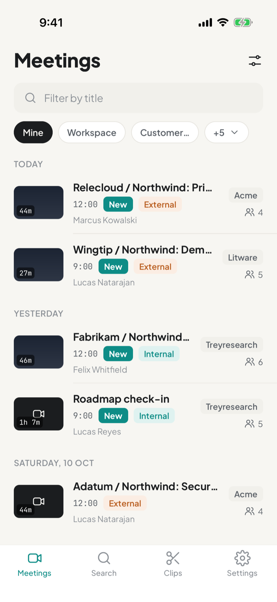
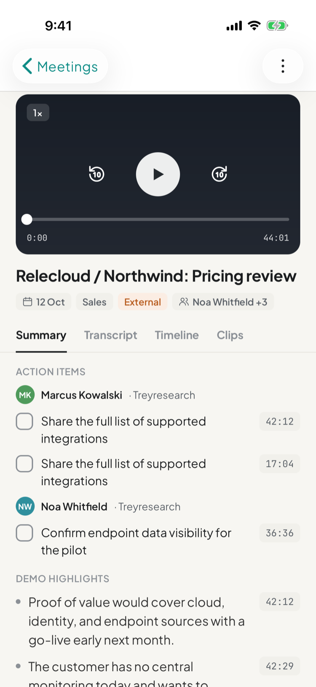
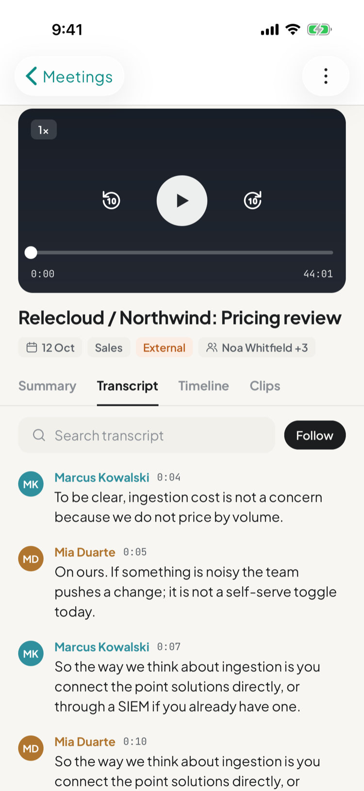
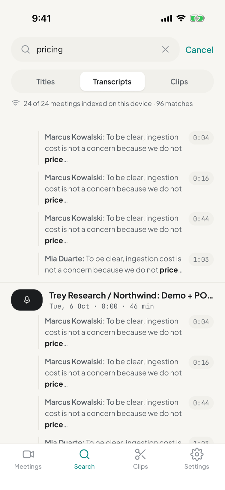

# Grist

An open-source mobile client for [Grain](https://grain.com) meeting recordings.
Listen to recordings, read AI notes and action items, follow transcripts, and
search across meetings from your phone. Built with React Native and Expo on
Grain's public API.

Grist is not affiliated with Grain. It is a client you bring your own Grain
account to.

## Screenshots

<table>
  <tr>
    <td align="center"><br>Meetings</td>
    <td align="center"><br>Summary</td>
    <td align="center"><br>Transcript</td>
    <td align="center"><br>Search</td>
  </tr>
</table>

## Layout

```
apps/mobile         Expo app (iOS and Android)
packages/grain-api  Typed client and schemas for the Grain public API
design/             Design canvas source (see design/build.py)
.claude/skills/     Project context and vendored agent skills
```

## Develop

```
npm ci
npm run lint
cd apps/mobile && npm test
cd apps/mobile && npx expo run:ios        # or: npx expo run:android
```

Machine setup, simulators, Maestro and EAS are covered in
`.claude/skills/dev-env/SKILL.md`; how work flows from issue to merge is in
`.claude/skills/development-flow/SKILL.md`.

Sign in with a Grain personal access token from
Account settings → Integrations → Personal API.

## License

MIT
